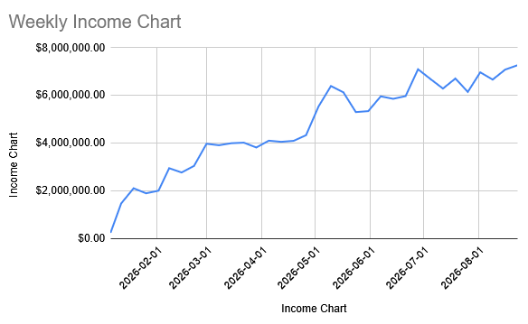
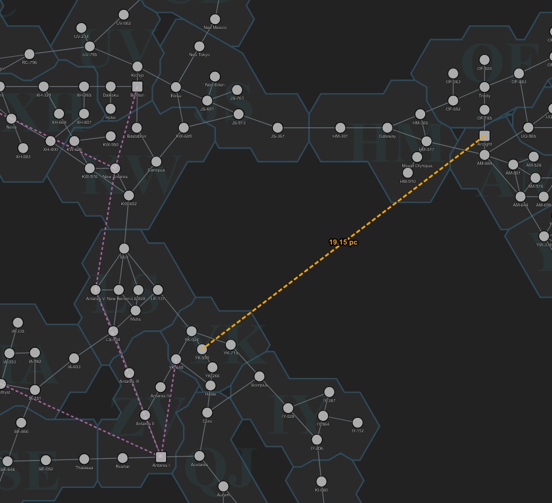

The ADI Gateway Cooperative is an Antares-based regional group focused on constructing gateways. By contributing resources to the gateways, members earn ownership shares proportional to their contributions. By banding together, [co-op members ensure the smooth operation of gateways](/adi-gateway-cooperative/) in Antares and beyond!

* AGC Gateway Phase 3 complete
* Reconciliation of Accounts
* Is ANT <-> Arclight next?

# AGC In Review

We've now completed the gates in the original AGC plan, plus the gate to Rhenos Pater in the void zone, plus the Eos <-> Norwick pair. Upon completion of all in-progress gates, I sat down and reconciled the sheet.

## Results of reconciliation:

At the end of the Gateway project, we had these excess contributions that I received but were not used in the project:

* 168 ABH	 
* 112 ADE	 
* 112 ASE	 
* 30 ATA	 
* 4 GWS	 
* 6 HSE	 
* 80 LTA	 
* 267 PSH	 
* 273 RDE	 
* 13 TRS	 
* 801 TSH	 
* 20 CBL	 

For these excess contributions, I simply subtracted them from my own contributions, since I assume many of them were materials that I used up for repairs and replaced as-needed with my own supply. 

A few exceptions were uncovered:
Melon was not properly credited for a GWS contributed on:
`3/9/2026	76203.7	CONT 9VHQGYJ 2`

As a result, I made and contributed another GWS, because I thought we were short. Melon has been credited and that accounts for one of the extra GWS. 

The 20 CBLs were accidentally recorded as 20 LCB. LCBs have no value to the gateway project, so they were worth no shares. Since these weren't counted, I later contributed an extra 20 CBL.

The TSH is a weird one because originally gateways had a much higher TSH requirement. When they were reduced, we already had more TSH than the original amount. I took the hit on the TSH shares and was able to sell some of them to other gateway people. 

The other 3 GWS, not sure how we got so far ahead. Partly just multiple people making them at the same time and going off pledge numbers that possibly weren't up to date. 

There was a math error where some contributions that didn't have corresponding pledges weren't counted. There are safeguards to prevent mismatches of contribution and pledge counts, but not missing pledges. The adjustments were fairly minor, except a few for me, and a few bigger ones for ZenWhisper. He had a few big items not counted. This will be corrected automatically in the next payout. 

There is a new "Invalid Mat" column, that will mark whenever a non-existing mat is entered into the ledger. This will help prevent those in the future. Overall there were just a handful of issues in the ledger table, which contains 536 entries, so I think it's pretty good. 

## Summary and Retrospective

Of our cash contributions, 98.15% have been allocated, leaving 15m remaining in cash. We had a late contribution of 66m, but fortunately it lined up nicely with our SP needs for the Norwick-Eos gates. In addition to that, we currently have $8m in "pending reinvestments"- these are people who asked for their AGC contributions to be rolled back into the project. This cash is in my account at the moment and will be released for the next project in big batches.

Overall, the ADI Gateway Cooperative was a huge logistic effort and I'm really proud of our work. I definitely have a bit of organizational burnout and will be handing off future gateway production projects to others in the project. I think we vastly underestimated the organizing and shipping costs, particularly moving all the SPT around, and the several hundred HCB trips to construct the gates. I designed the project so the organizer would eat any overages and bear the cost of non-optimal cash account spending, etc. I think overall that's a good design, but some sort of percentage/commission for cash buying would be helpful. Since we got a mix of currencies and a large amount of total cash (821m), with a peak holding of around 400m, managing buy orders across CXes was a lot of effort. Especially given that we effectively had hardcoded max prices for most of our purchases.

Anyway, all contributions are reconciled, and we have a clean slate for future AGC gateways!

## Gateway Income



While the ROI is quite long, the project continues to maintain a steady income.



## Gateway Income



Plxfox is proposing a new gateway that would connect ANT and ARC. Discuss in the #agc-shareholder-discussion discord. While the distance savings is enormous, we are unsure of traffic amounts.



## Join the efforts



